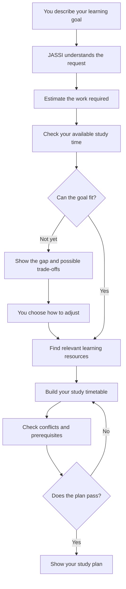
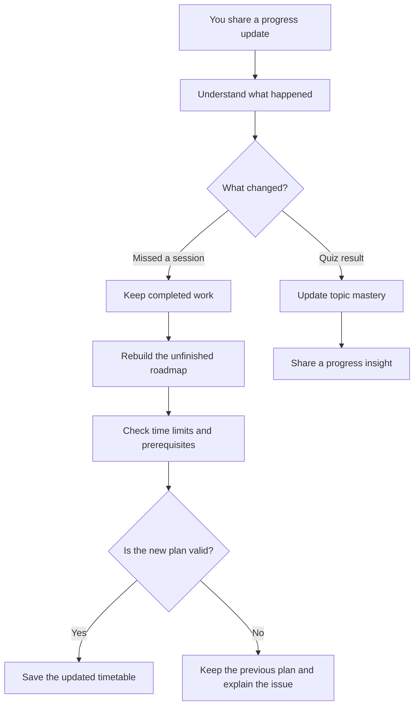
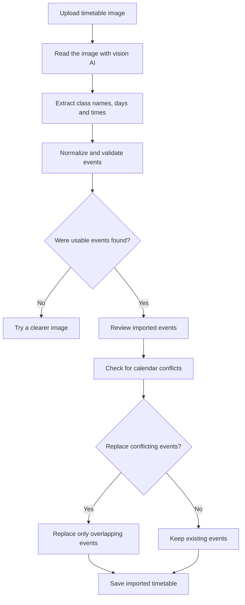

# JASSI — Your AI-Powered Learning Planner

JASSI helps you turn a learning goal into a study plan you can actually follow.

Tell it what you want to learn, how much time you have, and what your week looks like. JASSI checks whether your goal is realistic, finds useful learning resources, and builds a timetable around your existing commitments. If you miss a session or your progress changes, it can help adjust the plan.

The idea is simple: **a study plan should adapt to your life, not the other way around.**

## What can JASSI do?

- **Understand your goal.** Describe what you want to learn in everyday language.
- **Check if your goal is realistic.** JASSI compares the work ahead with the time you have.
- **Find learning resources.** It searches the resource collection for material related to your topics.
- **Build a timetable.** Study sessions are placed around classes and other commitments.
- **Explain its choices.** You get a plain-language explanation of the plan and its trade-offs.
- **Adjust when things change.** Missed sessions and quiz results can update the remaining plan and your estimated topic mastery.

JASSI uses an LLM for understanding and explanations. Important calculations—like available study time, scheduling, and plan checks—are handled by Python code so they can be tested consistently.

## How it works

### 1. From a goal to a study plan



### 2. When your week does not go to plan

JASSI can respond to a missed session or a quiz result. A missed session triggers a rebuild of the unfinished roadmap; completed work stays in your history.



### 3. Reading a timetable image

Upload a screenshot of your weekly timetable and JASSI will try to read the classes from it. The extracted events are normalized, checked, and shown for review before they are added. If an imported class overlaps an existing event, you can decide whether the imported timetable should replace that conflicting event.



## Project structure

Here is where the main parts of the project live:

```text
JASSI/
├── app/
│   ├── streamlit_app.py       # The dashboard you interact with
│   ├── graph.py               # Connects the steps in the AI workflow
│   ├── nodes/
│   │   ├── llm_nodes.py       # Groq calls for understanding and explanations
│   │   └── tool_nodes.py      # Connects workflow steps to Python tools
│   ├── tools/
│   │   ├── constraint_parser.py  # Reads and checks timetable events
│   │   ├── feasibility.py        # Estimates available study time
│   │   ├── scheduler.py          # Places study sessions
│   │   ├── verifier.py           # Checks the finished plan
│   │   ├── schedule_recovery.py  # Rebuilds the unfinished plan
│   │   └── resource_lookup.py    # Finds learning resources
│   └── vectorstore/
│       └── resource_retriever.py # Searches resources by meaning
├── data/
│   ├── topics.json             # Topics and their prerequisites
│   ├── resources.json          # Learning resource collection
│   └── demo_student.json      # Example student data
├── tests/                      # Automated tests
├── demo_script.py              # Runs an example workflow in the terminal
├── requirements.txt
└── .env.example
```

## Get it running

### What you need

- Python 3.12
- A Groq API key ([create one here](https://console.groq.com/keys))
- Git, if you are cloning the repository

### 1. Get the project

```bash
git clone <your-repository-url>
cd JASSI
```

If you already have the project downloaded, open a terminal in its root folder instead.

### 2. Create a virtual environment

**Windows PowerShell**

```powershell
py -3.12 -m venv .venv
.\.venv\Scripts\Activate.ps1
```

**Windows Command Prompt**

```cmd
py -3.12 -m venv .venv
.venv\Scripts\activate.bat
```

**macOS / Linux**

```bash
python3.12 -m venv .venv
source .venv/bin/activate
```

### 3. Install the packages

```bash
python -m pip install --upgrade pip
python -m pip install -r requirements.txt
```

### 4. Add your API key

Make a local copy of the example environment file:

**Windows**

```cmd
copy .env.example .env
```

**macOS / Linux**

```bash
cp .env.example .env
```

Open `.env` and add your Groq key:

```env
GROQ_API_KEY=your_groq_api_key_here
```

The example file also includes optional model settings. You can leave those as they are to use the defaults.

> Keep your real `.env` file private. Do not commit API keys or secrets to GitHub.

### 5. Start JASSI

```bash
streamlit run app/streamlit_app.py
```

Streamlit will print a local URL in your terminal. Open that URL in your browser to use the dashboard.

## Try the demo

You can also run the sample workflow from the terminal:

```bash
python demo_script.py
```

The demo walks through a learning request, a feasibility check, resource selection, schedule creation, and plan verification. It then demonstrates a missed session and a quiz update.

The demo uses the Groq API, so make sure your `.env` file is configured first.

## Run the tests

From the project root, run:

```bash
python -m pytest -q
```

The tests cover the core planning tools, including timetable parsing, scheduling, feasibility checks, recovery, resource lookup, and verification.

## Timetable imports

JASSI can accept timetable events from manual entries and timetable images. The image parser uses the configured vision model and can use local OCR as a fallback when available.

For image imports, the parser understands common time formats such as `08:30`, `8:30 AM`, and `14:30`. It also checks that the end time is later than the start time and removes duplicate events.

Google Calendar event normalization is present in the code, but the Google Calendar OAuth connection is not wired up yet. The app currently treats calendar commitments as recurring by weekday in several planning steps, so it is not a full date-by-date calendar sync.

## How resource search works

JASSI searches its resource collection by meaning, not just exact words. It tries to create a FAISS index using a sentence-transformers model. If the model cannot be downloaded or FAISS is unavailable, it falls back to TF-IDF search.

This fallback keeps resource lookup usable in environments where downloading embedding models is not possible.

## Current limitations

A few parts are still works in progress:

- **Google Calendar:** Event normalization exists, but OAuth sign-in and live event fetching are not connected.
- **Calendar dates:** Some planning logic uses recurring weekday commitments rather than a complete date-specific calendar.
- **Resource details:** User-added resources are based on the title, URL, and duration entered by the student. JASSI does not crawl every external course page.
- **Timetable editing:** Drag-and-drop editing is not available yet. You can manage events through the current calendar controls.
- **Student storage:** The demo stores student state in a local JSON file. It is intended for a single-user demo, not concurrent multi-user use.
- **Background updates:** Recovery runs when the Streamlit app runs; there is no separate worker monitoring deadlines while the app is closed.

## Built with

- [Python](https://www.python.org/)
- [Streamlit](https://streamlit.io/)
- [LangGraph](https://langchain-ai.github.io/langgraph/)
- [Groq](https://groq.com/)
- [FAISS](https://github.com/facebookresearch/faiss)
- [Sentence Transformers](https://www.sbert.net/)
- [scikit-learn](https://scikit-learn.org/)

---

Made to make learning plans a little more realistic—and a lot easier to adjust.
